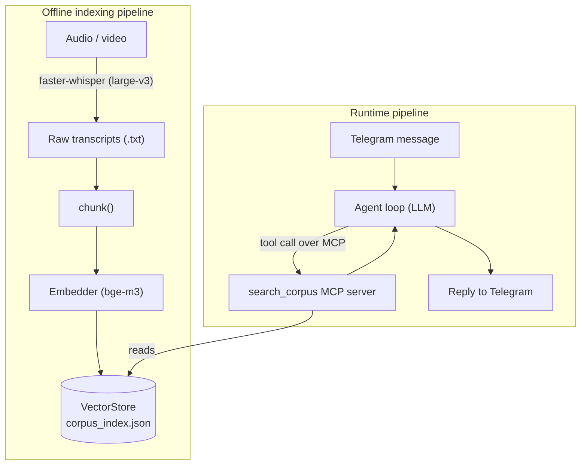

# corpus-agent

A Telegram bot that answers questions against my own personal corpus using retrieval-augmented generation (RAG), built from first principles.

## Why this exists

A pet project, built mainly out of curiosity, to get hands-on with:

- building a RAG pipeline myself — transcription, chunking, embeddings, retrieval — instead of a managed vector-search product
- an agentic loop with tool use over MCP (Model Context Protocol)
- using an LLM to navigate and extract information from a large, messy body of text without losing context
- working directly against different LLM provider APIs
- system design for a small but real multi-stage pipeline
- (next) containerizing and deploying it to a VPS

## What it does

An AI agent with a Telegram interface that answers questions against a personal knowledge base. The knowledge base is a collection of notes on a wide range of topics, mostly hormonal health, general health, and nutrition — sourced from a Telegram channel covering those subjects, and mostly converted from audio to text via transcription. [~X GB of raw notes.]

To retrieve from the knowledge base, the agent calls an MCP tool, `search_corpus`, which is the actual RAG pipeline underneath.

## Architecture

The two pipelines only meet at `corpus_index.json`: the indexing side builds it, the runtime side reads it. Nothing else connects them.

## Project structure

## Design goals & roadmap

| Goal | Status |
|---|---|
| **Precise fact extraction** — answer a specific factual question (e.g. "how many mg of X should I take") by pulling the exact relevant note |  Working — this is what top-k semantic search over chunks is good at |
| **Generalization** — synthesize a position across many notes, compare differing opinions, not just quote one chunk | Not solved yet — single-query top-k retrieval gives a few locally relevant chunks, not a synthesis across the whole corpus. Needs a different retrieval strategy (multiple queries, or a map-reduce pass over many chunks) |
| Evaluation harness (measure retrieval/answer quality against a known set of questions) |  In progress |
| Smarter chunking (sentence/topic-boundary aware, not pass-through word counting) |  Planned — next, after the eval baseline exists |
| Vector store beyond flat JSON |  Planned — Qdrant, once this is containerized |
| Score-based cutoff on search results (currently fixed top-k regardless of relevance) |  Planned |
| Containerized / deployed to a VPS |  Planned |
| Persistent conversation history |  Dropped — actual usage is one-off lookups, not long threads |
| Bring-your-own-corpus (configurable paths, generic prompt) |  Not a goal — this is a pet project, not a multi-tenant tool |
| LLM provider finalized |  Undecided (OpenAI-compatible / Grok) |
