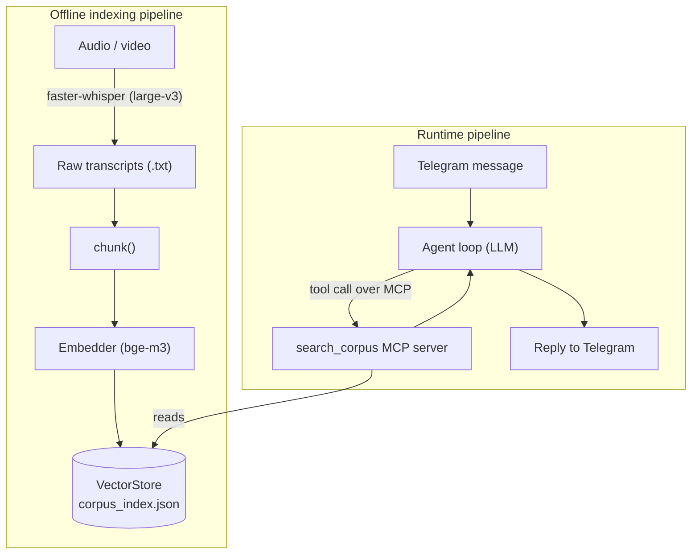

# corpus-agent

A Telegram bot that answers questions against my own personal corpus using retrieval-augmented generation (RAG), built from first principles.

## Why this exists

A pet project, built mainly out of curiosity, to get hands-on with:

- building a RAG pipeline myself — transcription, chunking, embeddings, retrieval — instead of a managed vector-search product
- an agentic loop with tool use over MCP (Model Context Protocol)
- using an LLM to navigate and extract information from a large, messy body of text without losing context
- working directly against different LLM provider APIs
- system design for a small but real multi-stage pipeline
- (next) containerizing and deploying it to a VPS

## What it does

An AI agent with a Telegram interface that answers questions against a personal knowledge base. The knowledge base is a collection of notes on a wide range of topics, mostly hormonal health, general health, and nutrition — sourced from a Telegram channel covering those subjects, and mostly converted from audio to text via transcription. [~X GB of raw notes.]

To retrieve from the knowledge base, the agent calls an MCP tool, `search_corpus`, which is the actual RAG pipeline underneath.

## Architecture

The two pipelines only meet at `corpus_index.json`: the indexing side builds it, the runtime side reads it. Nothing else connects them.

